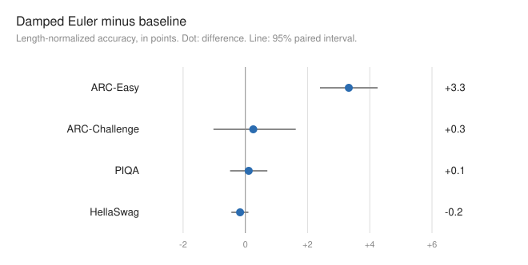
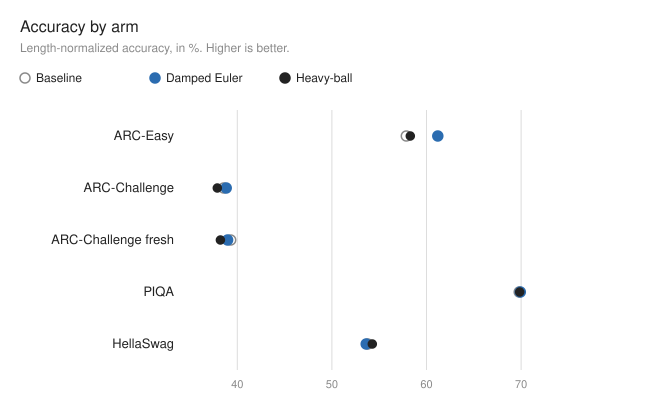

# arc-loops

Looping a few middle layers of a small language model (Qwen3-0.6B-Base), tested on four multiple-choice benchmarks.

**Original work:** [burtenshaw](https://huggingface.co/buckets/burtenshaw/qwen-arc-loop/tree/eval). This repo reruns it on Grid'5000 and adds PIQA and HellaSwag.

## Idea

Four middle layers are run twice with a damped update. No training. This adds 4 layer calls per forward pass (28 → 32).

## Results

Accuracy in %, length-normalized (acc_norm). Last column: damped Euler minus baseline, with 95% interval.

| Benchmark (questions) | Baseline | Damped Euler | Heavy-ball | Damped − baseline |
|---|---|---|---|---|
| ARC-Easy (2,376) | 57.9 | 61.2 | 58.3 | +3.3 [+2.4, +4.3] |
| ARC-Challenge (1,172) | 38.6 | 38.8 | 37.9 | +0.3 [−1.0, +1.6] |
| ARC-Challenge fresh (916) | 39.3 | 39.0 | 38.2 | −0.3 [−1.8, +1.1] |
| PIQA, validation (1,838) | 69.8 | 69.9 | 69.9 | +0.1 [−0.5, +0.7] |
| HellaSwag, validation (10,042) | 53.8 | 53.6 | 54.3 | −0.2 [−0.5, +0.1] |





Run on one H100 (bf16). Details: [RESULTS.md](RESULTS.md). Raw data: [HF bucket](https://huggingface.co/buckets/NoeFlandre/arc-loops).

- ARC-Easy gain reproduces.
- The original fresh ARC-Challenge gain does not reproduce.
- PIQA and HellaSwag show no clear change.

## Run it

On Grid'5000 (OAR, queue `abaca`):

```bash
# once per site, CPU
oarsub -q abaca -p gpu_count=0 "bash oar/env_build.sh"

# full run, one GPU
oarsub -q abaca -l gpu=1,walltime=2:00 "bash oar/run_eval.sh full"
```

## Files

- `loop_eval.py`: evaluation script (from the original work).
- `collect.py`: turns logs into a result JSON.
- `oar/`: Grid'5000 scripts.
- `RESULTS.md`: full numbers and notes.
- `env/requirements.txt`: pinned packages.

## Credit

Method, original code and original results: **burtenshaw**. Source: https://huggingface.co/buckets/burtenshaw/qwen-arc-loop/tree/eval
